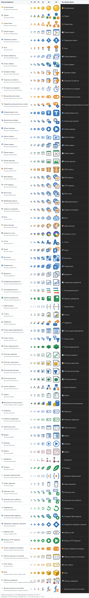

# Иконки метаданных 1С

Набор иконок для видов метаданных 1С:Предприятие 8: подсистемы, общие модули, роли, боты и другие объекты, для которых в библиотеке картинок платформы нет стандартной картинки.

Иконки нарисованы с нуля, графика платформы «1С:Предприятие» и 1C:EDT не копировалась и не обводилась. Метафоры и цветовая гамма подобраны так, чтобы иконки смотрелись рядом со стандартными картинками 1C:EDT.

Автор — Журавлев Анатолий.

Посмотреть иконки в светлой и тёмной теме и скачать их по одной можно на сайте [heart-machine.github.io/1c-metadata-icons](https://heart-machine.github.io/1c-metadata-icons/).

## Состав

Полный список иконок — в [icons.json](icons.json): имя файла, вид метаданных и имя общей картинки 1С («Метаданные» и вид метаданных в единственном числе: `МетаданныеРоль`, `МетаданныеОбщийМодуль`, `МетаданныеWebСервис`…). Исходники лежат в `src/16`, `src/20`, `src/24` и `src/32`.

## Скачать

Готовые файлы лежат в [последнем релизе](https://github.com/Heart-Machine/1c-metadata-icons/releases/latest):

- [1c-metadata-icons-pictures.zip](https://github.com/Heart-Machine/1c-metadata-icons/releases/latest/download/1c-metadata-icons-pictures.zip) — картинки для загрузки в EDT и Конфигуратор и скрипт, который добавляет их в проект EDT (см. [Выгрузка в проект 1C:EDT](#выгрузка-в-проект-1cedt));
- [1c-metadata-icons.cf](https://github.com/Heart-Machine/1c-metadata-icons/releases/latest/download/1c-metadata-icons.cf) — конфигурация с картинками для объединения в Конфигураторе (см. [Загрузка в Конфигуратор](#загрузка-в-конфигуратор));
- [1c-metadata-icons.cfe](https://github.com/Heart-Machine/1c-metadata-icons/releases/latest/download/1c-metadata-icons.cfe) — расширение с картинками (см. [Расширение](#расширение)).

Отдельные иконки — картинку 1С, PNG нужного размера и SVG-исходники — можно скачать на [сайте](https://heart-machine.github.io/1c-metadata-icons/). Там же есть архив всех PNG и SVG.

## Как выглядят иконки

Размеры 16 и 20 px соответствуют масштабам интерфейса 100% и 125%, 24–64 px — масштабам 150–400%.

Для 16, 20 и 24 px нарисованы отдельные SVG с привязкой прямых линий к пикселям: на 125% и 150% они не получаются дробным масштабированием соседней сетки. Сетки 20/24 адаптированы вручную; размер 28 px (175%) по-прежнему масштабируется из сетки 32×32.



## Установка

Для сборки нужен [Node.js](https://nodejs.org/ru) 20.15 или новее, лучше актуальная LTS-версия. Проверить установленную версию можно командой `node -v`.

### Windows

Установите Node.js LTS через winget:

```powershell
winget install OpenJS.NodeJS.LTS
```

Можно и без winget: скачайте установщик LTS-версии на [nodejs.org](https://nodejs.org/ru/download) и запустите его.

После установки откройте новое окно терминала и проверьте версии:

```powershell
node -v
npm -v
```

Если PowerShell пишет, что выполнение сценариев отключено в этой системе, запускайте команды в командной строке `cmd` или вызывайте `npm.cmd` вместо `npm`.

### Linux

В пакетах дистрибутивов Node.js часто устаревший, поэтому проще поставить его через [nvm](https://github.com/nvm-sh/nvm):

```bash
curl -o- https://raw.githubusercontent.com/nvm-sh/nvm/v0.40.8/install.sh | bash
```

Откройте новое окно терминала и установите LTS-версию:

```bash
nvm install --lts
```

Если `node -v` из пакетов дистрибутива показывает 20.15 или новее, можно обойтись без nvm.

### Репозиторий и зависимости

Команды одинаковы для Windows и Linux:

```bash
git clone https://github.com/Heart-Machine/1c-metadata-icons.git
cd 1c-metadata-icons
npm install
```

## Сборка

```bash
npm run build
```

Результат появляется в `dist/`:

- `png/<размер>/<имя>.png` — PNG размером 14, 16, 20, 24, 28, 32, 48 и 64 px;
- `1c/<имя>.zip` — картинка с вариантами для масштабов 85–400% и файлом `manifest.xml`, её можно загрузить в общую картинку 1С;
- `preview.html` — превью всех иконок для просмотра в браузере. Размеры и положение PNG привязаны к физическим пикселям экрана; в столбцах дерева автоматически выбран подходящий размер. Увеличенный образец — 16 px ×4. Для компенсации плотности нужен JavaScript, без него таблица тоже доступна.

Сборка также обновляет [docs/preview.svg](docs/preview.svg) — превью для GitHub, которое показано выше. Иконки встроены в этот файл, поэтому он открывается без остальных файлов репозитория.

## Сайт

```bash
npm run site
```

Команда собирает иконки и сайт в `dist/site/`: галерею с поиском, переключателем темы и масштаба 100–400%, панелью каждой иконки и файлами для скачивания. Сайт статический, ссылки в нём относительные, поэтому локально его можно открыть прямо из файла `dist/site/index.html`.

В панели можно скачать SVG всех четырёх сеток. Образцы 20 и 24 px показаны в исходном размере; увеличенные образцы — только 16 px ×4 и 32 px ×2, чтобы каждый пиксель увеличивался целое число раз. Архив PNG и SVG содержит все четыре набора исходников.

Размеры и положение PNG на сайте привязаны к физическим пикселям экрана, в том числе после смены масштаба страницы или переноса окна на другой монитор.

На [GitHub Pages](https://heart-machine.github.io/1c-metadata-icons/) сайт публикует GitHub Actions ([.github/workflows/pages.yml](.github/workflows/pages.yml)) после каждого пуша в `main`, если изменились иконки или скрипты. Картинки 1С, `.cf` и `.cfe` в блоке «Скачать всё» ведут на последний релиз, а PNG, SVG и картинки отдельных иконок собираются из `main`.

## Выгрузка в проект 1C:EDT

Скрипт собирает иконки и записывает их в проект EDT как общие картинки. Укажите каталог проекта или его `src`, то есть место, где лежит `Configuration/Configuration.mdo`:

```bash
npm run export:edt -- --dry-run "D:\path\to\project"
npm run export:edt -- "D:\path\to\project"
```

Ключи:

- `--dry-run` — только показать, что изменится;
- `--prefix <префикс>` — добавить префикс к именам картинок, например `--prefix Мой_` даст `Мой_МетаданныеРоль`. По умолчанию префикса нет.

Для каждой иконки в `CommonPictures/<картинка>/` появляются:

- `<картинка>.mdo` — создаётся один раз, при повторной выгрузке не перезаписывается;
- `Picture.zip` — обновляется при каждой выгрузке.

Картинка регистрируется в `Configuration.mdo`. После выгрузки обновите проект в EDT и используйте картинку в коде, например `БиблиотекаКартинок.МетаданныеРоль`.

Выгрузка ничего не меняет и просит задать префикс, если в конфигурации уже есть общая картинка:

- с таким же именем, созданная не этим скриптом;
- с именем, которое отличается только регистром, например `Метаданныероль` вместо `МетаданныеРоль`. В 1С имена не различают регистр. Со стандартными картинками платформы имена не пересекаются.

## Загрузка в Конфигуратор

Для Конфигуратора есть файл `1c-metadata-icons.cf`. Это конфигурация, в которой нет ничего, кроме общих картинок. Её объединяют со своей конфигурацией:

1. Сохраните свою конфигурацию в файл: «Конфигурация → Сохранить конфигурацию в файл». Так любое объединение можно будет откатить.
2. Выберите «Конфигурация → Сравнить, объединить с конфигурацией из файла» и укажите `1c-metadata-icons.cf`. Если Конфигуратор предложит поставить конфигурацию на поддержку, откажитесь: картинки добавятся как обычные объекты.
3. В окне сравнения оставьте флажки только у нужных общих картинок. Флажок у корня конфигурации нужно снять, иначе её имя, версия и режим совместимости заменят ваши.
4. Нажмите «Выполнить» и обновите конфигурацию базы данных.

`.cf` открывается в платформах 8.3.14 и новее: у него такой режим совместимости. Открытие и состав картинок проверены на платформах 8.3.27 и 8.5.1. Объединение с конфигурацией проверено вручную; сборка его не проверяет, потому что оно интерактивное.

## Расширение

`1c-metadata-icons.cfe` — расширение-дополнение «ИконкиМетаданных1С» с теми же общими картинками. Префикс имён у него `Метаданные`, режим совместимости 8.3.14. Язык «Русский» заимствуется по имени, поэтому расширение подключается к любой конфигурации с русским языком.

Картинки расширения видны только коду этого же расширения, основная конфигурация к ним не обращается. Поэтому `.cfe` нужен прежде всего тем, кто разрабатывает своё расширение: объедините его со своим расширением или возьмите за основу нового.

Сборка проверяет, что `.cfe` загружается в новую базу, применяется к базе данных и содержит те же картинки. Проверено на платформах 8.3.27 и 8.5.1. Объединение со своим расширением проверено вручную.

## Сборка релиза

```bash
npm run release
```

Команда собирает файлы для релиза в `dist/release/`:

- `1c-metadata-icons-pictures.zip` (`npm run package`) — готовые картинки, скрипт выгрузки в EDT и README с установкой Node.js. Скрипт из архива запускается без клонирования репозитория и без `npm install`.
- `1c-metadata-icons.cf` и `1c-metadata-icons.cfe` (`npm run package:1c`) — конфигурация и расширение с общими картинками.

Для `.cf` и `.cfe` нужны Windows, 1C:EDT, установленная через 1C:EDT Start, и платформа «1С:Предприятие» 8.3.14 или новее с Конфигуратором. Сборка берёт самую старую подходящую платформу и проходит цепочку: пустая база → проекты EDT с картинками → XML → базы → `.cf` и `.cfe`. В конце файлы загружаются в новые базы, расширение применяется к базе данных, и картинки побайтно сравниваются со сборкой. Пути находятся сами, при необходимости их задают переменные окружения:

- `V8_DESIGNER` — путь к `1cv8.exe`;
- `EDT_CLI` — путь к `1cedtcli.exe`;
- `EDT_JAVA_HOME` — каталог JDK, которую использует EDT.

## Исходники

- `src/16/*.svg` — сетка 16×16 для размеров 14 и 16 px;
- `src/20/*.svg` — отдельная сетка 20×20 для 20 px (125%);
- `src/24/*.svg` — отдельная сетка 24×24 для 24 px (150%);
- `src/32/*.svg` — сетка 32×32 для размеров 28, 32, 48 и 64 px.

На сетках 16 и 20 контур имеет толщину 1 px и проходит по полуцелым координатам, на 24 и 32 — 2 px по целым координатам. Заливки и пиксельные глифы привязаны к целым пикселям. Размеры 20 и 24 требуют отдельной подгонки геометрии, а не масштабирования исходника.

Мелкие внутренние детали сетки 24, например строки кода, сетка таблицы и конверт на плашке, могут иметь линии 1 px; основные рамки остаются 2 px.

Если сетки 20 или 24 пока нет, сборка использует соответственно исходник 16 или 32. Если у иконки есть только один исходник, он используется для всех размеров.

## Лицензия

© 2026 Журавлев Анатолий. Иконки распространяются по лицензии [CC BY 4.0](https://creativecommons.org/licenses/by/4.0/deed.ru): их можно использовать, изменять и распространять при условии указания автора.

Пример указания автора: «Иконки метаданных 1С © Журавлев Анатолий, CC BY 4.0».

Код сборки в каталоге `scripts/` распространяется по лицензии MIT, см. [scripts/LICENSE](scripts/LICENSE).
